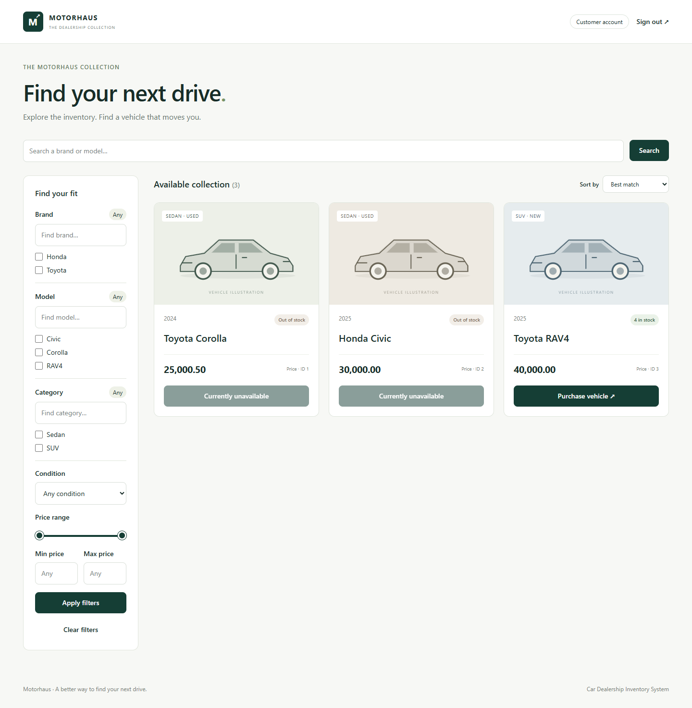
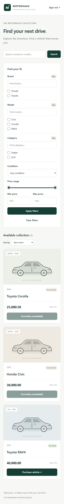
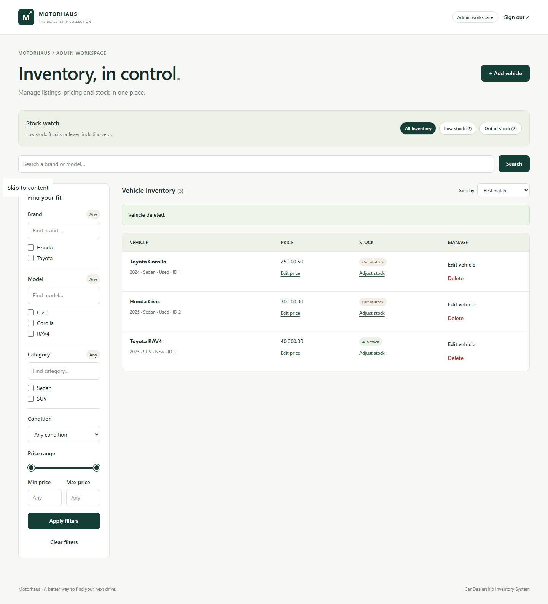

# Car Dealership Inventory System

A TDD-focused software engineering assignment implementing a full-stack car dealership inventory system: a FastAPI/PostgreSQL backend deployed on Render and a React + Tailwind CSS frontend deployed on Vercel.

## Current functionality

| Area                    | Status                                                                                                                                                                                                                                         |
| ----------------------- | ---------------------------------------------------------------------------------------------------------------------------------------------------------------------------------------------------------------------------------------------- |
| FastAPI health endpoint | Implemented: `GET /health` returns `{"status":"ok"}`.                                                                                                                                                                                          |
| PostgreSQL connectivity | Implemented: SQLAlchemy connection pool; `SELECT 1` check confirms reachability.                                                                                                                                                               |
| Registration            | Implemented: full name, email (normalized, validated), Argon2id password hash, `customer` role persisted. Extra fields including `role` are rejected.                                                                                          |
| Login                   | Implemented: email/password login returns an HS256-signed JWT valid for 30 minutes.                                                                                                                                                            |
| JWT verification        | Implemented as the reusable `get_current_user` dependency: validates signature, algorithm (HS256 only), expiry, required claims (`sub`, `iat`, `exp`), and live database user lookup.                                                          |
| Role handling           | Registration rejects client-supplied roles. `get_current_user` returns the current database role, not a token claim. Admin bootstrap via interactive `app.bootstrap_admin`.                                                                    |
| Vehicle inventory API   | Implemented: create, read, update, delete, search (with `q`, `make`, `model`, `category`, `min_price`, `max_price`, condition, sort), atomic purchase, atomic restock, admin stock adjustment (`/adjust-stock`), low-stock alerts (`/alerts`). |
| Schema migration        | Implemented: `app.migrate` applies DDL in a serialized transaction; adds `condition`, indexes, trigram support. `app.seed_catalogue` loads a 60-row sample.                                                                                    |
| CORS                    | Implemented: explicit origin allowlist with `_UnhandledExceptionMiddleware` ensuring 500 responses carry CORS headers for allowed origins.                                                                                                     |
| React frontend          | Implemented: customer storefront (search, filters, purchase), admin workspace (CRUD, price editing, stock adjustment, low-stock alerts), hash routing, session storage JWT, responsive/mobile layout.                                          |
| Deployment              | Backend on Render (`https://car-dealership-inventory-hcpa.onrender.com`). Frontend on Vercel (`https://car-dealership-inventory-flame.vercel.app`). See [frontend/README.md](frontend/README.md) for deploy steps.                             |
| Screenshots             | Playwright-generated screenshots from isolated test inventory — see [Screenshots](#screenshots) below.                                                                                                                                         |

## Tech stack

**Backend**

- Python 3.13 (verified: 3.13.5).
- FastAPI 0.162.0 and Uvicorn for the API.
- PostgreSQL 17, started with Docker Compose locally; hosted on Render in production.
- SQLAlchemy 2.1.6 and psycopg 3.3.6 for database access.
- Pydantic 2.14.1 and pydantic-settings 2.16.1 for validation and environment configuration.
- pwdlib (Argon2) for password hashing, PyJWT for tokens, email-validator for email validation.
- pytest 9.1.1 and FastAPI TestClient for tests.
- Starlette 1.9.0 (via FastAPI).

**Frontend**

- React 19.3.1 and TypeScript 7.0.2.
- Vite 8.3.5 (build + dev proxy).
- Tailwind CSS 4.3.3 via `@tailwindcss/vite`.
- Playwright 1.64.1 for browser integration tests (dev dependency).
- Node.js 24 (development/test environment).

Exact dependency versions are in [backend/requirements.txt](backend/requirements.txt) and [frontend/package.json](frontend/package.json).

## Project structure

```text
.
├── README.md
├── PROMPTS.md
├── TEST_REPORT.md
├── .env.example
├── docker-compose.yml
├── docs/
│   └── screenshots/             # Tracked genuine test screenshots
├── backend/
│   ├── README.md                # Backend operations, migration, seeding, admin bootstrap
│   ├── requirements.txt
│   ├── app/
│   │   ├── main.py              # FastAPI app, routers, validation error handler
│   │   ├── database.py          # Settings, connection pool, session factory
│   │   ├── models.py            # SQLAlchemy User and Vehicle models
│   │   ├── auth.py              # Registration, login, JWT dependency
│   │   ├── vehicles.py          # Vehicle CRUD, purchase, restock, adjustment, alerts
│   │   ├── vehicle_search.py    # Search filter/sort logic
│   │   ├── cors.py              # CORS allowlist middleware (with 500-safe inner middleware)
│   │   ├── init_db.py           # create_all for fresh databases
│   │   ├── migrate.py           # Explicit DDL migration (Phase 1)
│   │   ├── bootstrap_admin.py   # Interactive first-admin provisioning
│   │   └── seed_catalogue.py    # 60-row sample catalogue loader
│   ├── data/
│   │   └── sample_vehicles.csv
│   └── tests/
│       ├── conftest.py          # Isolated schema fixture
│       ├── test_health.py
│       ├── test_database.py
│       ├── test_auth.py
│       ├── test_inventory.py
│       ├── test_vehicles.py
│       ├── test_vehicle_search.py
│       ├── test_phase1.py       # Phase 1 migration, seeding, admin bootstrap, alerts
│       └── test_cors.py         # CORS allowlist and 500 header coverage
└── frontend/
    ├── README.md                # Frontend local setup, checks, deploy guide
    ├── package.json
    ├── vite.config.ts
    ├── playwright.config.ts
    ├── src/
    │   ├── main.tsx
    │   ├── App.tsx              # Auth flows, session management, routing
    │   ├── Dashboard.tsx        # Customer storefront and admin workspace
    │   ├── api.ts               # Typed API client (fetch-based)
    │   ├── ui.tsx               # Shared UI primitives
    │   └── styles.css
    ├── tests/
    │   └── api.test.mjs         # Database-free API client unit tests
    └── e2e/
        └── dashboard.spec.ts    # Playwright browser integration tests
```

The local `.env` and `.venv/` are deliberately ignored by Git. `frontend/node_modules/`, `frontend/dist/`, and `frontend/test-results/` are also ignored.

## Local setup

These instructions use **Windows PowerShell**, matching the development environment. Install Python 3.13, Git, Node.js 24, and Docker Desktop before starting.

### 1. Clone and install backend dependencies

```powershell
git clone https://github.com/Kanishq-Potdar/car-dealership-inventory.git
cd car-dealership-inventory
py -3.13 -m venv .venv
.\.venv\Scripts\python.exe -m pip install -r backend/requirements.txt
```

For an existing checkout, reuse its `.venv` and project directory.

### 2. Configure environment variables

```powershell
if (-not (Test-Path -LiteralPath .env)) {
    Copy-Item -LiteralPath .env.example -Destination .env
}
```

Edit `.env` using [.env.example](.env.example) as the template:

| Variable               | Purpose                                                                            |
| ---------------------- | ---------------------------------------------------------------------------------- |
| `DB_PASSWORD`          | Password used by Docker Compose when PostgreSQL first initializes.                 |
| `DATABASE_URL`         | SQLAlchemy connection URL with `postgresql+psycopg` driver. Match `DB_PASSWORD`.   |
| `JWT_SECRET`           | Randomly generated signing secret, minimum 32 characters. No application fallback. |
| `LOW_STOCK_THRESHOLD`  | Integer; admin alerts include stock at or below this value. Default `3`.           |
| `CORS_ALLOWED_ORIGINS` | JSON array of allowed browser origins. Use `[]` locally (Vite proxy handles it).   |

URL shape for the supplied Compose configuration:

```text
postgresql+psycopg://dealership:<URL-encoded password>@localhost:5432/dealership
```

Generate `JWT_SECRET` without printing it:

```powershell
@'
from pathlib import Path
import secrets
from dotenv import dotenv_values, set_key

path = Path('.env')
assert path.exists(), 'Copy .env.example to .env first'
if not dotenv_values(path).get('JWT_SECRET'):
    set_key(path, 'JWT_SECRET', secrets.token_hex(32))
print('JWT_SECRET configured; value not displayed.')
'@ | .\.venv\Scripts\python.exe -B -
```

### 3. Start PostgreSQL

```powershell
docker compose up -d db
docker compose ps
```

Wait for the database to become healthy. Data persists in the Compose-managed `postgres_data` volume.

### 4. Initialize and run the backend

From `backend/`:

```powershell
..\\.venv\Scripts\python.exe -B -m app.init_db
..\\.venv\Scripts\python.exe -B -m app.migrate
..\\.venv\Scripts\python.exe -B -m uvicorn app.main:app --reload
```

`init_db` creates missing tables. `migrate` applies Phase 1 DDL (idempotent). Optionally seed the 60-row sample:

```powershell
..\\.venv\Scripts\python.exe -B -m app.seed_catalogue
```

Optionally bootstrap the first admin account (interactive, hides password input):

```powershell
..\\.venv\Scripts\python.exe -B -m app.bootstrap_admin
```

Open:

- API documentation: <http://127.0.0.1:8000/docs>
- Health endpoint: <http://127.0.0.1:8000/health>

### 5. Frontend setup

From `frontend/` (Node.js 24):

```powershell
npm.cmd ci
npm.cmd run dev
```

Open the URL printed by Vite, normally `http://127.0.0.1:5173`. Vite proxies `/api` to `http://127.0.0.1:8000`; no CORS change is needed locally. To use a different backend, set `$env:API_TARGET = 'http://127.0.0.1:8001'` before starting Vite.

See [frontend/README.md](frontend/README.md) for the full deployment guide, Vercel settings, and Render CORS configuration.

## Authentication API

Both endpoints accept JSON. Example values are disposable demonstration data.

### Register: `POST /api/auth/register`

```json
{
  "full_name": "Alex Customer",
  "email": "alex@example.com",
  "password": "A long password 123!"
}
```

- `201`: `id`, `full_name`, `email`, `role` (`customer`).
- `409`: email already registered.
- `422`: missing/invalid fields or a supplied role.

### Login: `POST /api/auth/login`

```json
{
  "email": "alex@example.com",
  "password": "A long password 123!"
}
```

- `200`: `access_token` and `token_type` (`bearer`).
- `401`: `Invalid email or password` (same message for unknown email and wrong password).
- `422`: invalid or missing fields.

## Vehicle inventory API

All vehicle endpoints require `Authorization: Bearer <token>`. Admin-only endpoints additionally require the `admin` role in the current database record (not the JWT claim).

| Method   | Path                              | Auth     | Description                                                                                                           |
| -------- | --------------------------------- | -------- | --------------------------------------------------------------------------------------------------------------------- |
| `GET`    | `/api/vehicles/search`            | Customer | Search/filter/sort vehicles. Params: `q`, `make`, `model`, `category`, `min_price`, `max_price`, `condition`, `sort`. |
| `POST`   | `/api/vehicles`                   | Admin    | Create a vehicle listing.                                                                                             |
| `PUT`    | `/api/vehicles/{id}`              | Admin    | Replace a vehicle listing.                                                                                            |
| `DELETE` | `/api/vehicles/{id}`              | Admin    | Delete a listing.                                                                                                     |
| `POST`   | `/api/vehicles/{id}/purchase`     | Customer | Atomic stock decrement by 1. Returns `409` on zero stock.                                                             |
| `POST`   | `/api/vehicles/{id}/restock`      | Admin    | Add stock units.                                                                                                      |
| `POST`   | `/api/vehicles/{id}/adjust-stock` | Admin    | Signed delta adjustment. `{"delta": -2}` or `{"delta": 5}`. Returns `409` on negative result.                         |
| `GET`    | `/api/vehicles/alerts`            | Admin    | Listings at or below `LOW_STOCK_THRESHOLD`. Add `?out_of_stock=true` for zero-only.                                   |

## Running tests

### Backend

Start PostgreSQL and configure `.env` first. Tests use a real PostgreSQL connection and fail if it is unavailable. A running Uvicorn process is not required.

From `backend/`:

```powershell
..\\.venv\Scripts\python.exe -B -m pytest -q -p no:cacheprovider
```

Focused suites:

```powershell
# Database-free (CORS, health, search logic)
..\\.venv\Scripts\python.exe -B -m pytest tests/test_cors.py tests/test_health.py tests/test_vehicle_search.py -q -p no:cacheprovider

# Requires PostgreSQL
..\\.venv\Scripts\python.exe -B -m pytest tests/test_auth.py tests/test_inventory.py tests/test_vehicles.py tests/test_phase1.py -q -p no:cacheprovider
```

Tests create unique temporary schemas in the configured database, run all operations, and roll back on teardown. Development data is never reset or seeded.

### Frontend

From `frontend/`:

```powershell
# Database-free API client unit tests
npm.cmd run test:api

# Type-check
npm.cmd run check

# Full browser integration tests (requires PostgreSQL + backend)
npx.cmd playwright install chromium
npm.cmd test
```

Browser tests start dedicated API/Vite servers on ports 8011/5174, create a temporary schema, and drop it on completion. See [frontend/README.md](frontend/README.md) for full test coverage details.

See [TEST_REPORT.md](TEST_REPORT.md) for actual test run results.

## Deployment

| Component | Service | URL                                                  |
| --------- | ------- | ---------------------------------------------------- |
| Backend   | Render  | `https://car-dealership-inventory-hcpa.onrender.com` |
| Frontend  | Vercel  | `https://car-dealership-inventory-flame.vercel.app`  |

Render environment variables required: `DATABASE_URL` (with `postgresql+psycopg://` prefix), `JWT_SECRET`, `LOW_STOCK_THRESHOLD`, `CORS_ALLOWED_ORIGINS` (JSON array containing the exact Vercel production origin: `["https://car-dealership-inventory-flame.vercel.app"]`).

Vercel build settings: Root Directory `frontend`, Framework Preset `Vite`, Install Command `npm ci`, Build Command `npm run build`, Output Directory `dist`, environment variable `VITE_API_BASE_URL=https://car-dealership-inventory-hcpa.onrender.com`.

See [frontend/README.md](frontend/README.md#deploy-to-vercel-with-the-render-backend) for the full deployment checklist.

## Screenshots

The screenshots below are Playwright-generated captures from isolated test inventory (three seeded test vehicles). They are not production data and do not show real dealership listings or prices. The image files are stored in `docs/screenshots/` and tracked in the repository.

### Customer storefront — desktop



The storefront shows the vehicle collection with brand/model/category multi-select filters, condition dropdown, price range controls, and a search bar. Stock-available vehicles show a purchase button; out-of-stock vehicles are disabled.

### Customer storefront — mobile



The same storefront in a narrow viewport: filters stack above the vehicle list and the layout adapts for touch use.

### Admin workspace



The admin workspace shows the inventory management table with stock-watch alerts panel, search, and per-vehicle edit price, adjust stock, and delete actions. The "+ Add vehicle" button opens a creation form.

> **Note:** These screenshots come from the Playwright test suite's isolated temporary schema. Image files are stored in `docs/screenshots/` (tracked in Git) as well as the test runner's ignored output directory `frontend/test-results/`.

## My AI Usage

## Student AI-Usage Reflection

I used ChatGPT, OpenAI Codex, and Antigravity at different stages of this project. I began with ChatGPT for brainstorming, understanding the assignment, defining the scope, and planning the development workflow before writing application code. I then used Codex extensively during implementation, testing, debugging, and documentation. Antigravity helped investigate and fix a CORS issue involving unhandled server errors and also assisted with the final documentation review.

My approach was iterative rather than accepting AI-generated code without checking it. I wanted to follow a test-driven development workflow: understand the requirement, write focused tests, observe failures where practical, implement the required behavior, and rerun the tests. For example, the database connectivity and authentication work involved tests that failed when the required functionality was missing and passed after implementation. I also reviewed test output to distinguish genuine assertion failures from setup or import errors.

Through this process, I developed a better understanding of PostgreSQL connectivity and session management, password hashing, JWT authentication, and role-based authorization. I also learned that security decisions must be enforced by the backend rather than relying on frontend controls. During the CORS investigation, I gained a better understanding of how ASGI middleware ordering affects whether browser responses include CORS headers, including when the server returns an unexpected 500 error.

AI assistance also required verification and correction. I reviewed suggested changes, checked Git history and co-author attribution, and used test results to evaluate whether fixes worked. For the final documentation, I distinguished recently rerun tests from historical results and identified missing evidence rather than presenting incomplete transcripts as complete records.

Overall, AI tools helped me work through unfamiliar implementation details faster and made it easier to iterate across the backend, frontend, tests, and deployment configuration. However, the experience also showed me that generated code and explanations are not automatically correct. I remain responsible for understanding the system, checking the evidence, protecting credentials, and being transparent about what was tested and what remains incomplete.

## Running tests (results summary)

See [TEST_REPORT.md](TEST_REPORT.md) for detailed results, commands, dates, and warnings.

## Remaining work and open items

- **Student reflection**: must be written by the student and added to [PROMPTS.md](PROMPTS.md).
- **Screenshots in Git**: captured in `docs/screenshots/` and embedded in this README; confirm inclusion in submission package.
- **Full conversation transcripts**: complete ChatGPT/Codex/Antigravity export or shared links, if required by the rubric (a shared link for ChatGPT is supplied in [PROMPTS.md](PROMPTS.md)).
- **Original assignment brief**: supply for a final rubric check; the complete rubric has not been verified from this repository.
- **Trigram extension**: `pg_trgm` is available on the inspected PostgreSQL 17 installation but must be installed and migration rerun for typo-tolerant search; this is optional.
- **No payment processing or order history**: explicit design decision documented in [frontend/README.md](frontend/README.md).
